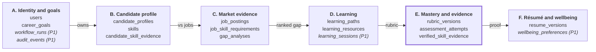

# CareerBridge DB Layer Design

Nov 14, 2026 · Patchai Kaliaperumal · [Live version (Claude Doc)](https://claude.ai/artifact/FsVRRCZyPtt9iwxtYmSJHJ)

## Overview

Version 2 matches the updated CareerBridge MVP design: 18 Postgres tables in 6 domains, with 14 needed for the weekend demo. Every gap traces to a job excerpt, every mastered skill to a frozen-rubric attempt, and every résumé export to a user approval.

| Decision | Choice | Why |
| --- | --- | --- |
| Database | Supabase Postgres (free tier) | Shared by the team; JSONB, foreign keys and triggers built in |
| Files | Supabase Storage, private bucket | Spec keeps uploads and exports out of the database; signed URLs only |
| Keys and time | UUID primary keys; `created_at` and `updated_at` on every table | Spec requirement; safe to expose IDs |
| Variable data | Constrained JSONB for milestones, rubric criteria, test results, résumé diffs | Shapes vary by skill; checked against `database/models.py` before saving |
| Fixed data | Normalized rows for skills, evidence and job requirements | These are queried, ranked and traced |
| Interface | Python functions in `database/`, one file per domain | No module writes SQL; FastAPI routes call these |
| Fallback | SQLite with the same schema, minus triggers (not built yet) | Offline demo backup |

**What changed from v1:** résumé files are now stored privately (v1 stored text only); skills are normalized into a shared `skills` table; jobs carry per-skill requirements with excerpts; and new domains cover mastery (rubrics, attempts, verified evidence), résumé versions and wellbeing. One table, `workflow_runs`, is added beyond the spec's list to hold the resumable state from its appendix.

## At a glance



The data follows the product loop: a user's profile is compared to jobs, a ranked gap opens a learning path, a frozen rubric grades the attempt, and only passing evidence reaches the résumé. Italic tables are P1. Wellbeing never feeds scoring.

## Tables by domain

All tables also have `id` (UUID primary key), `created_at` and `updated_at`. P0 = needed for the weekend demo; P1 = after the vertical slice works.

### A. Identity and goals

| Table | Columns | Links | Priority |
| --- | --- | --- | --- |
| `users` | `email` (unique), `name`, `auth_provider`, `preferences_json`, `consent_at` | — | P0 |
| `career_goals` | `user_id`, `target_role`, `location`, `seniority`, `learning_goal`, `modality` (`text`, `hands_on`, `both`), `is_active` | → users | P0 |
| `workflow_runs` | `user_id`, `goal_id`, `state` (see Status values), `state_json`, `next_action`, `retry_count`, `errors_json` | → users, career_goals | P1 |
| `audit_events` | `user_id`, `event_type`, `entity_type`, `entity_id`, `detail_json`, `occurred_at` | → users | P1 |

### B. Candidate profile

| Table | Columns | Links | Priority |
| --- | --- | --- | --- |
| `candidate_profiles` | `user_id`, `source` (`resume`, `manual`), `file_ref`, `parsed_text`, `experience_json`, `confirmed_at` | → users | P0 |
| `skills` | `canonical_name` (unique), `category` (`technical`, `interpersonal`, `domain`), `aliases_json`, `parent_skill_id` | → skills (parent) | P0 |
| `candidate_skill_evidence` | `profile_id`, `skill_id`, `evidence_type` (`resume`, `self_reported`, `diagnostic`), `excerpt`, `status` | → candidate_profiles, skills; unique (profile, skill) | P0 |

### C. Market evidence

| Table | Columns | Links | Priority |
| --- | --- | --- | --- |
| `job_postings` | `provider` (`adzuna`, `greenhouse`, `cached`, `synthetic`), `provider_job_id`, `title`, `company`, `location`, `url`, `description`, `completeness` (`full`, `partial`), `retrieved_at` | unique (provider, provider_job_id) | P0 |
| `job_skill_requirements` | `job_id`, `skill_id`, `importance` (`required`, `preferred`), `excerpt`, `confidence` | → job_postings, skills | P0 |
| `gap_analyses` | `goal_id`, `profile_id`, `job_ids_json`, `existing_skills_json`, `market_skills_json`, `ranked_gaps_json` (each up to 10) | → career_goals, candidate_profiles | P0 |

### D. Learning

| Table | Columns | Links | Priority |
| --- | --- | --- | --- |
| `learning_paths` | `goal_id`, `skill_id`, `objective`, `milestones_json`, `status` | → career_goals, skills | P0 |
| `learning_resources` | `skill_id`, `title`, `provider`, `url`, `price_type` (`free`, `paid`, `mixed`, `unknown`), `modality`, `level`, `concepts_json`, `verified_at` | → skills | P0 |
| `learning_sessions` | `path_id`, `milestone_id`, `mode` (`written`, `hands_on`), `state_json`, `hint_count` | → learning_paths | P1 |

### E. Mastery and evidence

| Table | Columns | Links | Priority |
| --- | --- | --- | --- |
| `rubric_versions` | `skill_id`, `version`, `criteria_json`, `approval_status`, `frozen_at` | → skills; unique (skill, version) | P0 |
| `assessment_attempts` | `user_id`, `rubric_id`, `quiz_results_json`, `project_results_json`, `score_json`, `status`, `idempotency_key` (unique) | → users, rubric_versions | P0 |
| `verified_skill_evidence` | `user_id`, `skill_id`, `attempt_id` (unique), `scope`, `summary`, `verified_at` | → users, skills, assessment_attempts | P0 |

### F. Résumé and wellbeing

| Table | Columns | Links | Priority |
| --- | --- | --- | --- |
| `resume_versions` | `profile_id`, `base_file_ref`, `changes_json`, `evidence_ids_json`, `status`, `approved_at`, `export_file_ref`, `idempotency_key` | → candidate_profiles | P0 |
| `wellbeing_preferences` | `user_id` (primary key), `opted_in`, `support_style`, `last_checkin_at` | → users; no link to any scoring table | P1 |

All foreign keys to `users` cascade on delete, so "delete my data" removes everything a user owns. `skills`, `job_postings` and `learning_resources` are shared reference data and are not deleted with a user.

## Status values

Each status column accepts only the values below, enforced by a Postgres `CHECK` constraint and the shared models.

| Column | Allowed values | Key rule |
| --- | --- | --- |
| `candidate_skill_evidence.status` | `present`, `user_confirmed`, `self_reported`, `not_established`, `demonstrated` | A skill missing from the résumé is `not_established`, never "absent" |
| `rubric_versions.approval_status` | `draft`, `reviewed`, `frozen` | Only `frozen` rubrics can be used for an attempt |
| `assessment_attempts.status` | `in_progress`, `submitted`, `passed`, `failed`, `needs_review` | `needs_review` when grading is unreliable |
| `learning_paths.status` | `proposed`, `approved`, `in_progress`, `completed`, `paused` | `paused` can come from a wellbeing request |
| `resume_versions.status` | `draft`, `approved`, `exported`, `rejected` | Export only from `approved` |
| `workflow_runs.state` | `ONBOARDING`, `PROFILE_REVIEW`, `JOB_SEARCH`, `GAP_ANALYSIS`, `PATH_APPROVAL`, `LEARNING`, `ASSESSING`, `REMEDIATION`, `EVIDENCE_VERIFIED`, `RESUME_REVIEW`, `EXPORT_READY` | Transitions follow the spec's state table |

## Interfaces

One Python file per domain in `database/`. Every function returns plain dicts or lists and raises `DBError` with a readable message. FastAPI routes call these; no module writes SQL. Wherever a function takes `skill`, it accepts a skill name, alias or UUID; new names are added to `skills` automatically. Usage examples are in [`database/README.md`](../database/README.md); the HTTP endpoints that call them are in [`api/openapi.yaml`](../api/openapi.yaml).

### Setup (`database/admin.py`)

Tables are created by running `database/schema.sql` once in the Supabase SQL Editor (the Python client cannot run DDL).

| Function | What it does |
| --- | --- |
| `health_check() → bool` | Confirms database and storage connections |
| `table_counts()` | Row count per table |
| `seed_demo_data()` | Loads the demo persona, synthetic jobs (`provider="synthetic"`), placeholder RAG resources and the frozen RAG rubric v1; safe to rerun |
| `delete_demo_data()` | Removes the demo persona and everything it owns |
| `top_skill_gaps(limit=10)` · `export_user_data(user_id)` | Reports |

### A. Identity and goals (`database/users.py`)

| Function | Notes |
| --- | --- |
| `create_user(email, name)` · `get_user(id)` · `get_user_by_email(email)` · `list_users(limit=100)` · `update_user(id, **fields)` | Create returns the existing user if the email exists |
| `delete_user(id)` | Cascades to all user-owned rows and deletes their stored files |
| `create_goal(user_id, target_role, location, seniority, learning_goal, modality)` · `get_goal(id)` · `get_active_goal(user_id)` · `list_goals(user_id)` · `update_goal(id, **fields)` · `delete_goal(id)` | Creating a goal deactivates the previous one |
| `create_workflow(user_id, goal_id)` · `save_workflow_state(id, state, state_json, next_action)` · `record_workflow_error(id, error)` · `get_workflow(id)` | P1; rejects unknown states; max 3 retries |
| `log_event(user_id, event_type, entity_type, entity_id, detail)` · `list_events(user_id)` | P1; no résumé text in `detail` |

### B. Candidate profile (`database/profiles.py`)

| Function | Notes |
| --- | --- |
| `create_profile(user_id, source, parsed_text, file_bytes, file_name)` · `get_profile(id)` · `get_latest_profile(user_id)` · `list_profiles(user_id)` · `delete_profile(id)` | Uploads the .pdf/.docx privately; delete also removes stored files |
| `confirm_profile(id)` · `clear_parsed_text(id)` · `resume_file_url(id)` | Confirmation is required before job search |
| `add_skill_evidence(profile_id, skill, evidence_type, excerpt, status)` · `add_skill_evidence_bulk(profile_id, items)` | Resolves aliases to a canonical skill first |
| `list_skill_evidence(profile_id, status=None)` · `update_skill_evidence(id, status, excerpt=None)` · `delete_skill_evidence(id)` | User corrections during review; `demonstrated` is refused here |
| `get_or_create_skill(name, category)` · `find_skill(name_or_alias)` · `list_skills(category=None)` · `add_alias(skill_id, alias)` | Shared taxonomy |

### C. Market evidence (`database/jobs.py`)

| Function | Notes |
| --- | --- |
| `upsert_job_posting(job)` | Needs `provider`, `provider_job_id`, `title`, `url`; deduplicates on provider + ID |
| `add_job_requirements(job_id, requirements)` | Each needs `skill`, `importance`, `excerpt` |
| `get_job(id)` · `list_jobs(ids)` · `list_requirements(job_id)` · `delete_job(id)` | |
| `create_gap_analysis(goal_id, profile_id, job_ids, existing_skills, market_skills, ranked_gaps)` | Max 10 per list; each gap names its source job IDs |
| `get_gap_analysis(id)` · `get_latest_gap_analysis(goal_id)` · `list_gap_analyses(goal_id)` · `delete_gap_analysis(id)` | Versioned snapshots, never edited in place |
| `gap_report(id)` | Gaps with job titles, links and the excerpts that ask for each skill |

### D. Learning (`database/learning.py`)

| Function | Notes |
| --- | --- |
| `create_path(goal_id, skill, objective, milestones)` · `get_path(id)` · `list_paths(goal_id)` · `update_path_status(id, status)` · `update_milestones(id, milestones)` · `delete_path(id)` | Paths start as `proposed` |
| `add_resource(skill, resource)` · `list_resources(skill, price_type=None, limit=5)` · `mark_resource_verified(id)` · `delete_resource(id)` | Returns up to 5 per price type; never padded |
| `save_session(path_id, milestone_id, mode, state)` · `get_session(id)` | P1 |

### E. Mastery and evidence (`database/mastery.py`)

| Function | Notes |
| --- | --- |
| `create_rubric(skill, criteria)` · `approve_rubric(id)` · `freeze_rubric(id)` · `update_rubric_draft(id, criteria)` · `get_rubric(id)` · `get_frozen_rubric(skill)` · `list_rubrics(skill)` | Draft → reviewed → frozen; frozen is read-only |
| `start_attempt(user_id, rubric_id, idempotency_key)` | Refused unless the rubric is frozen; same key returns the same attempt |
| `submit_attempt(attempt_id, outcome, quiz_results, project_results, score)` · `get_attempt(id)` · `list_attempts(user_id, skill=None)` | `outcome` is `passed`, `failed` or `needs_review`; repeat submits return the first result |
| `record_verified_evidence(attempt_id, scope, summary)` | Refused unless the attempt `passed`; sets the skill to `demonstrated` |
| `list_verified_evidence(user_id)` | Read by the résumé exporter |

### F. Résumé and wellbeing (`database/resumes.py`, `database/wellbeing.py`)

| Function | Notes |
| --- | --- |
| `create_resume_draft(profile_id, changes, evidence_ids)` · `get_resume_version(id)` · `list_resume_versions(profile_id)` · `update_resume_draft(id, changes)` · `delete_resume_version(id)` | Changes may cite only the user's verified evidence IDs |
| `approve_resume(id)` · `reject_resume(id)` | Approval timestamp is required for export |
| `record_export(id, file_bytes, file_name, idempotency_key)` · `export_url(id)` | Refused unless `approved`; stores the file privately |
| `set_wellbeing_preferences(user_id, opted_in, support_style)` · `record_checkin(user_id)` · `get_wellbeing_preferences(user_id)` · `delete_wellbeing_preferences(user_id)` | P1; never read by matching, grading or export code |

## Integrity rules

The spec's six preserved decisions are enforced in the database or the `database/` layer, not left to each module.

| Rule | Enforced by |
| --- | --- |
| A missing keyword is not a missing skill | Default evidence status `not_established`; `demonstrated` only via `record_verified_evidence` |
| Every gap traces to a job | Each ranked gap carries source job IDs; requirements need an `excerpt` |
| No invented jobs | `job_postings.url` and `provider` are required; `cached` and `synthetic` providers are labeled in the UI |
| Rubric cannot change after freezing | Database trigger blocks updates to a row with `frozen_at` set; changes create a new version |
| Attempts use frozen rubrics only | `start_attempt` and a database trigger check `approval_status = frozen` |
| Mastery needs a passing attempt | `verified_skill_evidence.attempt_id` is unique and a trigger requires a `passed` attempt by the same user |
| Résumé claims need evidence | Draft changes may cite only the user's verified evidence IDs |
| Export needs approval | `record_export` refuses unless status is `approved`; a `CHECK` constraint requires `approved_at` |
| Repeat submits are safe | Unique `idempotency_key` on attempts and exports |
| Wellbeing stays separate | `wellbeing_preferences` has no foreign key from any scoring table; matching, grading and export code never import `database/wellbeing.py` |
| Privacy | Row-level security on every table (only the server-side secret key can read); files in a private bucket via signed URLs; no résumé text in logs; cascading delete |
| Untrusted content | Résumé and job text stored as data only, validated against schemas before saving |
| Limits | Up to 10 existing, market and gap skills; up to 5 free and 5 paid resources; up to 3 remediation retries per task |

## Storage, configuration and files

Files go to a private Supabase Storage bucket; the database keeps only their paths (`file_ref`).

| Bucket path | Contents | Deleted when |
| --- | --- | --- |
| `resumes/{user_id}/{profile_id}.pdf` | Uploaded résumé | Profile or user is deleted |
| `exports/{user_id}/{resume_version_id}.docx` and `.pdf` | Approved résumé exports | Résumé version or user is deleted |

`.env` in the repo root (never committed):

```
SUPABASE_URL=https://<project>.supabase.co
SUPABASE_KEY=<secret key>        # server side only
STORAGE_BUCKET=careerbridge-private
```

### Files in the repo

| File | Purpose |
| --- | --- |
| `database/schema.sql` | Tables, `CHECK` constraints, integrity triggers, row-level security, grants, storage bucket |
| `database/models.py` | Pydantic shapes for every JSONB column and function input |
| `database/client.py` | Connection, `DBError`, storage helpers |
| `database/users.py`, `profiles.py`, `jobs.py`, `learning.py`, `mastery.py`, `resumes.py`, `wellbeing.py`, `admin.py` | Interface functions by domain |
| `database_tests/test_db_setup.py` | Connection, 18 tables, bucket, write test |
| `database_tests/test_db_layer.py` | Full flow and every integrity rule, with cleanup |
| `db_requirements.txt` | Python dependencies |
| `api/openapi.yaml` | HTTP contract for the UI and backend |

### Build order

This follows the spec's advice to freeze three contracts first.

1. Schema for domains A–C (users, goals, profiles, skills, evidence, jobs, requirements, gap analyses), plus seed data. **Done**
2. Contract 1: job requirement → normalized skill (`add_job_requirements`, `find_skill`). **Done**
3. Domain D: learning paths and resources. **Done**
4. Contract 2: skill gap → frozen rubric (`create_rubric`, `freeze_rubric`, trigger). **Done**
5. Contract 3: passing attempt → verified evidence → résumé draft (`submit_attempt`, `record_verified_evidence`, `create_resume_draft`). **Done**
6. Export with approval, then P1 tables (`workflow_runs`, `audit_events`, `learning_sessions`, `wellbeing_preferences`). **Done in the data layer**
7. Tests for every integrity rule (**done**), then the SQLite fallback (open).

**Open question:** confirm the job provider (Adzuna credentials or Greenhouse public boards) before seeding real jobs, so `provider` values match.
